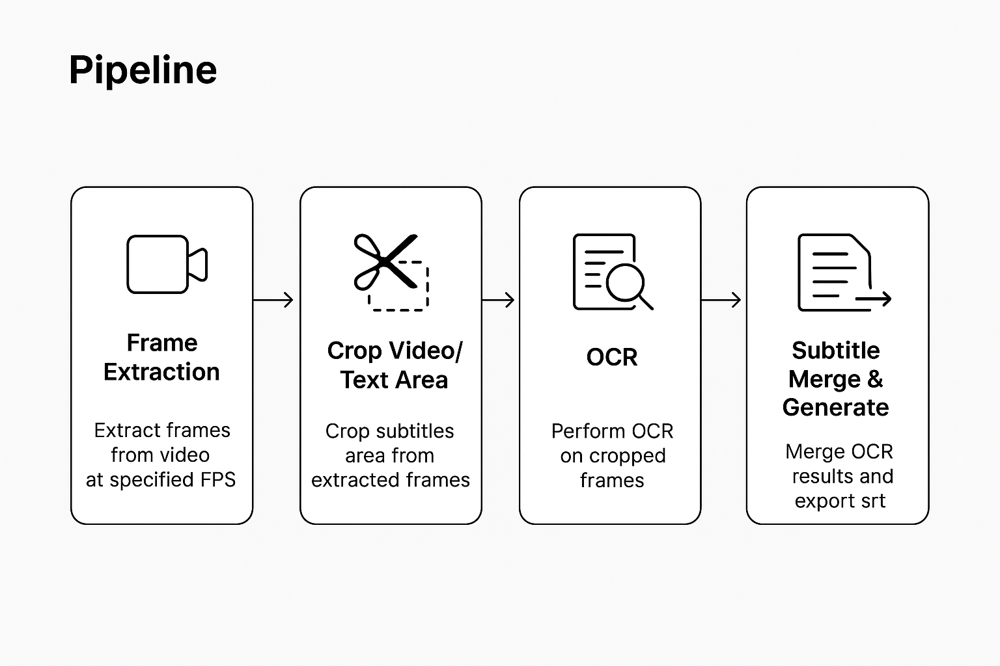
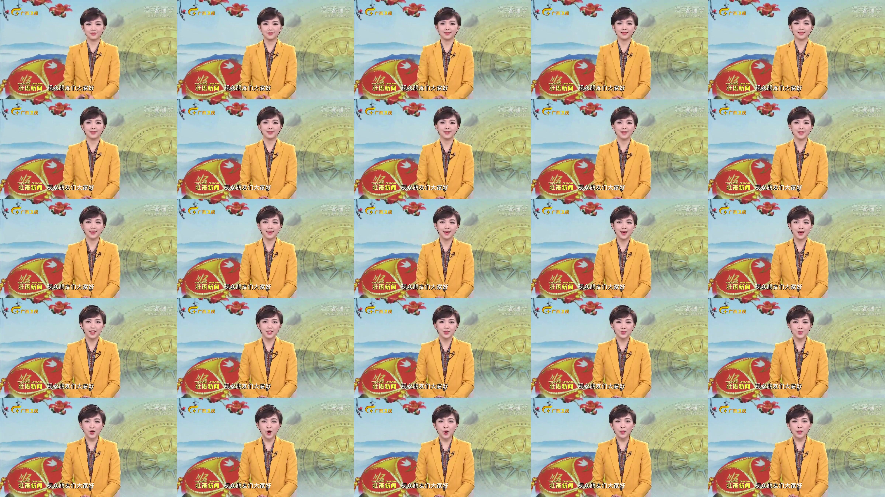
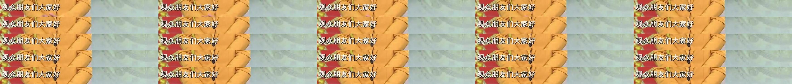

# VideoSubtitleExtractor

## Install

### 推荐 CUDA 11.8，其它版本参考[PaddleOCR官网](https://www.paddlepaddle.org.cn/install/quick?docurl=/documentation/docs/zh/develop/install/pip/linux-pip.html)

```sh
pip install -r requirements.txt
```

## Code Structure

### Quick Start
```py
python main.py
```

```md
CreateSpeechLabelFromVideo
├── core
│   ├── cropper.py 音视频区域裁剪
│   ├── frame_skip.py 音视频抽帧
│   ├── ocr_module.py Paddleocr-v5 模型识别
│   └── subtitle_generator.py 字幕文件合并，生成
├── main.py 核心主程序入口
├── README.md
├── requirements.txt
└── utils 多卡批量并行处理
    ├── batch_ffmpeg.py
    ├── batch_main_cut.py
    └── batch_main_ocr_sub.py
```

## Pipeline



### 音视频抽帧（Frame Extraction）
视频会根据设定的 FPS 进行抽帧，将连续的视频流拆分成等间隔的图片帧，便于后续进行 OCR 与字幕生成。



### 区域裁剪（Crop Video）
由于视频中通常只有部分区域包含字幕，本步骤会自动裁剪出你定义的文本区域（ROI），减少 OCR 输入规模，提高识别精度和速度。



### OCR 文本识别（PaddleOCR v5）
通过 PaddleOCR 的 OCR 模型对裁剪后的字幕区域进行逐帧识别，输出按时间顺序排列的识别结果。

```md
1011/25 观众朋友们大家好 100
1012/25 观众朋友们大家好 100
1013/25 观众朋友们大家好 100
1014/25 观众朋友们大家好 100
1015/25 观众朋友们大家好 100
1016/25 观众朋友们大家好 100
1017/25 观众朋友们大家好 100
1018/25 观众朋友们大家好 100
1019/25 观众朋友们大家好 100
1020/25 欢迎您收看《壮语新闻》我是黄利莉 0
1021/25 欢迎您收看《壮语新闻》我是黄利莉 100
1022/25 欢迎您收看《壮语新闻》我是黄利莉 100
1023/25 欢迎您收看《壮语新闻》我是黄利莉 100
1024/25 欢迎您收看《壮语新闻》我是黄利莉 100
1025/25 欢迎您收看《壮语新闻》我是黄利莉 100
1026/25 欢迎您收看《壮语新闻》我是黄利莉 100
1027/25 欢迎您收看《壮语新闻》我是黄利莉 100
1028/25 欢迎您收看《壮语新闻》我是黄利`梨` 94
......
```

### 字幕文件合并（Subtitle Merge）
OCR 输出的逐帧文本会经过去噪、基于文本相似度算法将重复内容合并，并基于帧率生成精确时间戳，最终自动整合同一内容的连续帧并导出为 `.srt` 字幕文件用于后续 ASR 训练。

#### 示例输出（srt）：
```lua
1
00:00:39,000 --> 00:00:40,920
观众朋友们大家好

2
00:00:40,920 --> 00:00:43,719
欢迎您收看《壮语新闻》我是黄利莉

3
00:00:43,759 --> 00:00:46,079
面对开放发展带来的

4
00:00:46,079 --> 00:00:48,439
出入境人数持续增长新形势

......
```